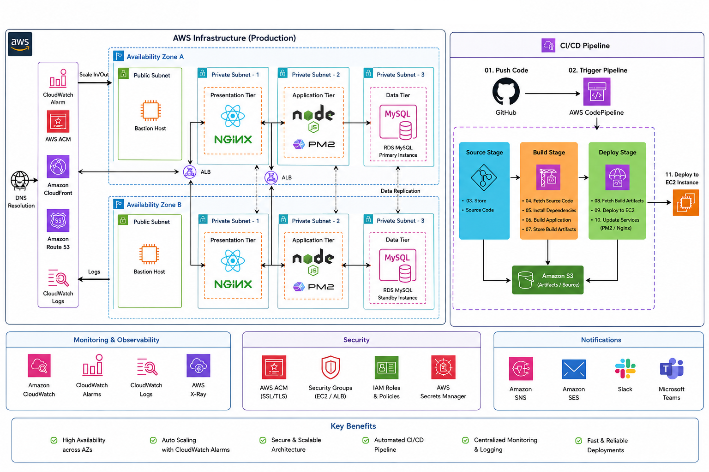

# ☁️ AWS 3-Tier CI/CD Pipeline: Production-Grade React + Node.js + MySQL App

Deploys a production-style **3-tier full-stack application** (React/Nginx web tier, Node.js/PM2 app tier, RDS MySQL database tier) on **AWS**. The infrastructure runs in a custom VPC across two Availability Zones, and **AWS CodePipeline, CodeBuild and CodeDeploy** automate every deployment after a `git push`.

## 🏗️ Architecture



## 🧰 Tech Stack

| Layer | Technology |
|---|---|
| Presentation tier | React, Nginx (EC2 + Auto Scaling) |
| Application tier | Node.js, PM2 (EC2 + Auto Scaling) |
| Database tier | Amazon RDS MySQL |
| Networking | VPC, public/private subnets, IGW, NAT, Route tables, ALB (external + internal) |
| CI/CD | GitHub, AWS CodePipeline, CodeBuild, CodeDeploy, S3 (artifacts) |
| Secrets | AWS Systems Manager Parameter Store |
| Monitoring | CloudWatch Logs, Metrics and Alarms |
| Security | Security Groups, IAM Roles, ACM (HTTPS) |
| DNS / CDN | Route 53, CloudFront |

## 🔄 CI/CD Flow

```
Developer → GitHub (push) → CodePipeline
   ├─ Source stage : fetch code from GitHub
   ├─ Build stage  : CodeBuild runs buildspec.yml (install deps, build, store artifacts in S3)
   └─ Deploy stage : CodeDeploy runs appspec.yml on the Auto Scaling Group
                     (PM2 restart for backend / Nginx update for frontend)
```

Two independent pipelines are used:

| Pipeline | Build project | Deploy app | Target ASG |
|---|---|---|---|
| `Backend-Pipeline` | `backend-build` | `backend-deploy` | `application-tier-ASG` |
| `frontend-Pipeline` | `frontend-build` | `frontend-deploy` | `web-tier-ASG` |

- `buildspec.yml` tells **CodeBuild** how to install dependencies, build and package the artifacts.
- `appspec.yml` tells **CodeDeploy** how to copy files and run the install/start scripts on the EC2 instances.

## 📁 Repository Structure

```
aws-3tier-cicd-codepipeline-react-node-mysql/
├── frontend/
│   ├── src/ ...
│   ├── buildspec.yml
│   ├── appspec.yml
│   └── scripts/
├── backend/
│   ├── db/                 # SQL commands to create database and tables
│   ├── buildspec.yml
│   ├── appspec.yml
│   └── scripts/
├── app-tier-user-data.sh   # Launch template user-data (application tier)
├── web-tier-user-data.sh   # Launch template user-data (web tier)
├── Architecture.png
└── README.md
```

## 📥 Clone

```bash
git clone https://github.com/vikasjagtap9696/aws-3tier-cicd-codepipeline-react-node-mysql.git
cd aws-3tier-cicd-codepipeline-react-node-mysql
```

---

# 🚀 Complete Working Process

## Build order

1. Create VPC, subnets, IGW, NAT, route tables
2. Create Security Groups
3. Create S3 bucket for artifacts
4. Create IAM roles
5. Create RDS MySQL
6. Launch Bastion Host and set up the database
7. Application tier (Launch Template → Target Group → Internal ALB → ASG)
8. Web tier (Launch Template → Target Group → External ALB → ASG)
9. Store secrets in Parameter Store
10. CodeBuild → CodeDeploy → CodePipeline (backend, then frontend)
11. HTTPS, CloudFront and Route 53

---

## Step 1: Create the VPC

| Setting | Value |
|---|---|
| Name | `3-tier-project` |
| CIDR | `192.168.0.0/16` |
| Tenancy | Default |
| DNS hostnames | Enabled (VPC Actions → Edit DNS hostnames) |

1. Create an Internet Gateway `3-tier-project-IGW` and attach it to the VPC.
2. Create **8 subnets**:

| Subnet | CIDR | Purpose |
|---|---|---|
| PublicSubnet-1a | 192.168.1.0/24 | Bastion / ALB / NAT |
| PublicSubnet-1b | 192.168.2.0/24 | Bastion / ALB |
| PrivateSubnet-Web-1a | 192.168.3.0/24 | Web tier |
| PrivateSubnet-Web-1b | 192.168.4.0/24 | Web tier |
| PrivateSubnet-App-1a | 192.168.5.0/24 | App tier |
| PrivateSubnet-App-1b | 192.168.6.0/24 | App tier |
| PrivateSubnet-Db-1a | 192.168.7.0/24 | Database |
| PrivateSubnet-Db-1b | 192.168.8.0/24 | Database |

3. Create a **NAT Gateway** `3-tier-project-NAT` with an Elastic IP in `PublicSubnet-1a`.
4. Create route tables:
   - `3-tier-project-public-rt` → route `0.0.0.0/0` to the IGW, associate both public subnets
   - `3-tier-project-private-rt` → route `0.0.0.0/0` to the NAT, associate all 6 private subnets
5. Enable **Auto-assign public IP** on both public subnets (Actions → Edit subnet settings).

## Step 2: Create Security Groups

| Security Group | Inbound rules |
|---|---|
| `Bastion-SG` | SSH (22) from your IP (avoid `0.0.0.0/0` in real use) |
| `WebALB-SG` | HTTP (80), HTTPS (443) from `0.0.0.0/0` |
| `Web-SG` | HTTP/HTTPS from `WebALB-SG`; SSH from `Bastion-SG` |
| `AppALB-SG` | HTTP/HTTPS from `Web-SG` |
| `App-SG` | Custom TCP **3200** from `AppALB-SG`; SSH from `Bastion-SG` |
| `Database-SG` | MySQL (3306) from `App-SG` and `Bastion-SG` |

## Step 3: Launch the Bastion Host

- AMI: Amazon Linux 2023
- Subnet: public subnet, Security Group: `Bastion-SG`
- (Alternative: use AWS SSM Session Manager instead of a bastion.)

## Step 4: Create IAM Roles

| Role | Trusted entity | Permissions |
|---|---|---|
| `3-tier-ec2-role` | EC2 | CloudWatchLogsFullAccess, CloudWatchAgentServerPolicy, AmazonEC2RoleforAWSCodeDeploy |
| `3-tier-codebuild-role` | CodeBuild | AmazonS3FullAccess, AWSCodeBuildAdminAccess, AmazonSSMReadOnlyAccess, CloudWatchLogsFullAccess |
| `3-tier-codedeploy-role` | CodeDeploy | AWSCodeDeployRole, CloudWatchLogsFullAccess, CloudWatchAgentServerPolicy |
| `3-tier-codepipeline-role` | CodePipeline | Pipeline permissions (the project used Admin for learning only. Use least privilege in real projects) |

## Step 5: Create RDS MySQL

1. Create a **DB Subnet Group** `tier-Subnet-Group` using `PrivateSubnet-Db-1a` and `PrivateSubnet-Db-1b`.
2. Create the database:

| Setting | Value |
|---|---|
| Engine | MySQL |
| Identifier | `dev-db-instance` |
| Username | `admin` |
| Password | *(choose a strong password, never commit it)* |
| VPC | `3-tier-project` |
| Subnet group | `tier-Subnet-Group` |
| Public access | **No** |
| Security Group | `Database-SG` |
| Encryption | Enabled |

3. Note the **RDS endpoint**. You will need it for Parameter Store.

## Step 6: Set up the database from the Bastion Host

```bash
sudo -s
cd /home/ec2-user

# Install MySQL client
sudo dnf install mariadb105 -y

# Connect to RDS
mysql -h <RDS-ENDPOINT> -u admin -p
```

Run the SQL commands from `backend/db` to create the database (`react_node_app`), the app user (`appuser`) and the tables.

## Step 7: Application tier (Node.js + PM2)

**1. Launch Template**

| Setting | Value |
|---|---|
| Name | `application-tier-LT` |
| AMI | Amazon Linux 2023 |
| Type | `t2.micro` |
| Security Group | `App-SG` |
| Instance profile | `3-tier-ec2-role` |
| User data | `app-tier-user-data.sh` |

**2. Target Group (empty)**: `app-tier-tg`, Instance type, HTTP, port **3200**, health check path `/health`.

**3. Internal ALB**: `app-tier-internal-alb`, scheme **Internal**, subnets `PrivateSubnet-App-1a/1b`, SG `AppALB-SG`, listener HTTP 80 → `app-tier-tg`.

**4. Auto Scaling Group**: `application-tier-ASG`, template `application-tier-LT`, subnets `PrivateSubnet-App-1a/1b`, attach `app-tier-tg`, enable ELB health checks, **Desired 2 / Min 2 / Max 4**, target tracking on **Average CPU 70%**, CloudWatch group metrics enabled.

## Step 8: Web / presentation tier (React + Nginx)

**1. Launch Template**: `web-tier-LT`, Amazon Linux 2023, `t2.micro`, SG `Web-SG`, instance profile `3-tier-ec2-role`, user data `web-tier-user-data.sh`.

> Edit the user-data so Nginx proxies API calls to the **internal ALB DNS name** (`http://<internal-alb-dns>`).

**2. Target Group (empty)**: `web-tier-tg`, health check path `/health`.

**3. External ALB**: `web-tier-external-alb`, scheme **Internet-facing**, subnets `PublicSubnet-1a/1b`, SG `WebALB-SG`, listener HTTP 80 → `web-tier-tg`.

**4. Auto Scaling Group**: `web-tier-ASG`, template `web-tier-LT`, subnets `PrivateSubnet-Web-1a/1b`, attach `web-tier-tg`, ELB health checks on, **Desired 2 / Min 2 / Max 4**, CPU target 70%.

Open the **external ALB DNS name** in a browser to see the Nginx page.

**CloudWatch:** check **CloudWatch → Log groups**. If `node-app-logs-backend` is missing, create it manually.

## Step 9: Store secrets in Parameter Store

Create these parameters in **Systems Manager → Parameter Store** (Standard tier, Type String, or SecureString for the password):

| Parameter | Value |
|---|---|
| `/nodeapp/db/hostname` | RDS endpoint |
| `/nodeapp/db/name` | `react_node_app` |
| `/nodeapp/db/user` | `appuser` |
| `/nodeapp/db/password` | *(your password)* |
| `/nodeapp/db/port` | `3306` |

`backend/buildspec.yml` reads them like this:

```yaml
env:
  parameter-store:
    DB_PASSWORD: "/nodeapp/db/password"
    DB_HOST: "/nodeapp/db/hostname"
    DB_PORT: "/nodeapp/db/port"
    DB_USER: "/nodeapp/db/user"
    DB_NAME: "/nodeapp/db/name"
```

## Step 10: Artifact bucket

Create a **private S3 bucket**, for example `3-tier-project-codebuild-artifacts`. Use your own globally unique name.

## Step 11: GitHub connection

**CodePipeline → Settings → Connections → Create connection** → GitHub → name `githubconnection` → authorize the AWS Connector for GitHub → install the app on your repository → Connect.

---

## Step 12: CI/CD for the Application tier

### CodeBuild: `backend-build`

| Setting | Value |
|---|---|
| Source | GitHub → this repository |
| Webhook | Rebuild on **Push** (single build) |
| Service role | `3-tier-codebuild-role` |
| Buildspec | `backend/buildspec.yml` |
| Log group | `codebuild-logs-backend` |

> If webhook creation fails: edit the project and retry. If it still fails, add it manually in GitHub: **Repo → Settings → Webhooks** → URL `https://codebuild.<region>.amazonaws.com/webhook`, content type `application/json`.

### CodeDeploy: `backend-deploy`

| Setting | Value |
|---|---|
| Platform | EC2 |
| Deployment group | `backend-Deployment-grp` |
| Service role | `3-tier-codedeploy-role` |
| Type | In-place |
| Environment | Auto Scaling Group `application-tier-ASG` |
| Deployment config | `CodeDeployDefault.AllAtOnce` |
| Load balancer | Enabled → `app-tier-tg` |

### CodePipeline: `Backend-Pipeline`

| Stage | Configuration |
|---|---|
| Role | `3-tier-codepipeline-role` |
| Artifact store | Custom location → your artifact bucket |
| Source | GitHub (v2 / GitHub App), connection `githubconnection`, branch `main`, trigger on Push to `main` |
| Build | CodeBuild → `backend-build` (skip test phase) |
| Deploy | CodeDeploy → `backend-deploy` / `backend-Deployment-grp` |

## Step 13: CI/CD for the Web tier

Repeat Step 12 with these values:

| Item | Value |
|---|---|
| CodeBuild project | `frontend-build` |
| Buildspec | `frontend/buildspec.yml` |
| Log group | `codebuild-logs-frontend` |
| CodeDeploy app / group | `frontend-deploy` / `frontend-Deployment-grp` |
| ASG | `web-tier-ASG` |
| Target group | `web-tier-tg` |
| Pipeline | `frontend-Pipeline` |

## Step 14: HTTPS, CloudFront and Route 53

1. Request a certificate in **AWS ACM** for your domain.
2. Add an HTTPS (443) listener on the external ALB with the ACM certificate and redirect HTTP → HTTPS.
3. Create a **CloudFront** distribution in front of the external ALB.
4. Create a **Route 53** record (Alias) pointing your domain to CloudFront or the ALB.

## Step 15: Test the pipeline

1. Change a line in `frontend/` or `backend/` and `git push` to `main`.
2. Watch **CodePipeline** go through Source → Build → Deploy.
3. Open your domain (or the ALB DNS) to confirm the change.

---

## 🛠️ Troubleshooting

| Problem | Fix |
|---|---|
| Targets unhealthy in `app-tier-tg` | Check that the health-check port matches the app port (**3200**) and that `/health` returns 200. Test on the instance with `curl http://localhost:3200/health` |
| CodeBuild cannot read parameters | Confirm `AmazonSSMReadOnlyAccess` on `3-tier-codebuild-role` and that the parameter names match `buildspec.yml` |
| CodeDeploy fails on an instance | Check that the CodeDeploy agent is running and that the instance role is `3-tier-ec2-role` |
| Private instances cannot download packages | Check the NAT Gateway and the `3-tier-project-private-rt` route |
| `node-app-logs-backend` missing in CloudWatch | Create the log group manually |
| GitHub webhook not created | Retry in CodeBuild, or add it manually in GitHub Webhooks |
| Web tier cannot reach the backend | Make sure Nginx uses the **internal ALB DNS name** and `AppALB-SG` allows `Web-SG` |

## 🧹 Cleanup (avoid AWS charges)

Delete in this order: CodePipelines → CodeDeploy apps → CodeBuild projects → Auto Scaling Groups → Load Balancers and Target Groups → Launch Templates → RDS instance (and subnet group) → Bastion Host → NAT Gateway and release the Elastic IP → VPC → S3 bucket → IAM roles → Parameter Store entries.

## 🔐 Security Notes

- Never commit database passwords, endpoints, tokens or keys to GitHub. Use Parameter Store or Secrets Manager.
- Restrict Bastion SSH to your own IP.
- Replace Admin and FullAccess policies with least-privilege policies for production.
- Keep RDS private (**Public access = No**) and encrypted.

## 🚧 Future Improvements

- RDS **Multi-AZ** (primary + standby) as shown in the diagram
- AWS Secrets Manager with automatic rotation
- AWS X-Ray tracing
- CloudWatch Alarms with SNS / SES / Slack / Teams notifications
- Infrastructure as Code with Terraform or CloudFormation
- Blue/green deployments and an automated test stage

## 👤 Author

**Vikas Jagtap**
- GitHub: [@vikasjagtap9696](https://github.com/vikasjagtap9696)

⭐ If this project helped you, give the repo a star!